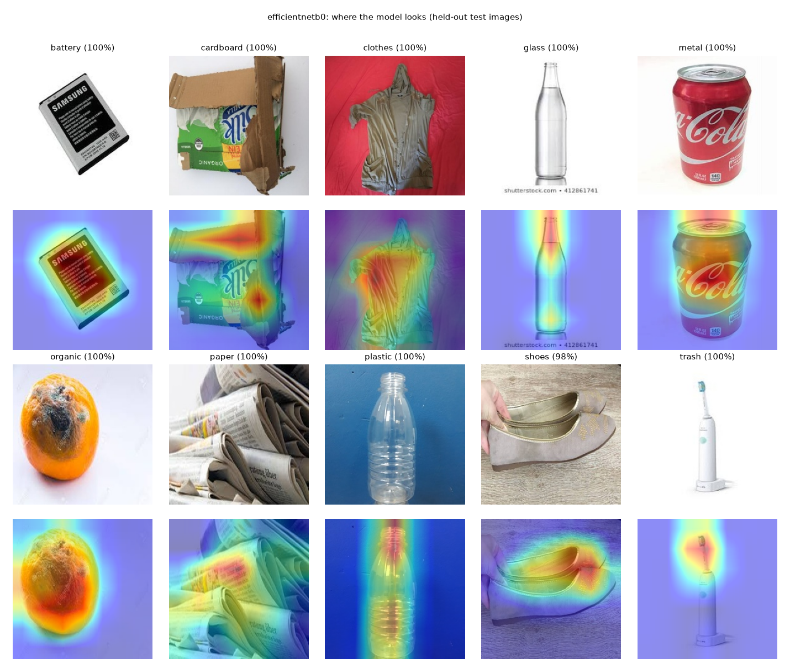

# ♻️ RecycleVision — Garbage Image Classification Using Deep Learning

Upload a photo of a waste item and RecycleVision classifies it into one of **10 categories**:
battery, cardboard, clothes, glass, metal, organic, paper, plastic, shoes and trash. It returns a
confidence score, the top-3 predictions, the disposal stream and a **Grad-CAM** heatmap showing what the model looked at.

**Domain:** waste management, environmental tech, computer vision · **Stack:** Python, TensorFlow/Keras, Streamlit

<!-- RESULTS:START -->
## Results (held-out test set: 2,423 images never used for training or model selection)

| Model | Test accuracy | Macro-F1 [95% CI] | Precision | Recall | Size | CPU latency* |
|---|---|---|---|---|---|---|
| **EfficientNetB0 (deployed)** | **96.5%** | **0.963** [0.955–0.971] | 0.962 | 0.965 | 18 MB | 158 ms |
| MobileNetV2 | 94.5% | 0.943 [0.933–0.952] | 0.940 | 0.945 | 11 MB | 59 ms |
| ResNet50 | 93.8% | 0.936 [0.926–0.945] | 0.934 | 0.939 | 97 MB | 171 ms |
| Baseline CNN (from scratch) | 56.3% | 0.556 [0.534–0.575] | 0.586 | 0.560 | 5 MB | 33 ms |

\*Single image on an Apple M2 CPU. EfficientNetB0 was selected by the highest **validation** macro-F1; McNemar's test
shows its advantage over every other model is significant (p < 0.001). Top-3 accuracy is 99.7%; the average
false-positive rate per class is 0.40%. Full analysis: [`reports/RecycleVision_Report.pdf`](reports/RecycleVision_Report.pdf).


<!-- RESULTS:END -->

## Why this matters

Manual waste sorting is slow, unpleasant and error-prone, and mis-sorted items contaminate whole batches of recyclables.
An image classifier enables:

- **Smart recycling bins** that sort items automatically.
- **Municipal sorting lines** with less manual labour.
- **Educational tools** that teach people to segregate waste.
- **Analytics** on waste composition.

## The dataset: three Kaggle datasets merged into one clean set

The brief links three datasets. Using all of them gives more, and more varied, training images, **but they overlap
heavily**. Most of the 10-class dataset is copied from the 12-class one, and both contain the 6-class TrashNet photos.
Naively concatenating them would put the same photo in both the training and test sets, which inflates test accuracy.
`scripts/prepare_data.py` therefore:

| Step | What it does | Result |
|---|---|---|
| Scan | Reads all 30,301 images straight from the three zips; maps folder names to one 10-class taxonomy (brown/green/white glass → glass, biological → **organic**) | 30,301 images |
| Validate | Drops unreadable, tiny (< 64 px) or blank images | 7 removed |
| De-duplicate | Removes exact copies (SHA-1) and near-copies (resized or re-encoded: perceptual-hash distance ≤ 8 **and** thumbnail correlation ≥ 0.95, a threshold calibrated by visual inspection), across all sources | 11,232 removed |
| Label conflicts | Drops photos whose copies carry different labels in different datasets | 20 removed |
| Cap | Caps any class at 2,500 images (clothes alone was a third of the data) | 2,889 removed |
| Split | Stratified 70 / 15 / 15 train / validation / test | 11,307 / 2,423 / 2,423 |

Every raw image and its fate is recorded in [`data/manifest.csv`](data/manifest.csv). Rebuilding the dataset on any
machine (laptop or Colab) is deterministic and size-checked against the exact Kaggle versions used.

| Source (Kaggle) | Raw images | Kept |
|---|---|---|
| [Garbage Classification, 12 classes](https://www.kaggle.com/datasets/mostafaabla/garbage-classification) | 15,515 | 10,187 |
| [Garbage Classification V2, 10 classes](https://www.kaggle.com/datasets/sumn2u/garbage-classification-v2) | 12,259 | 3,487 |
| [Garbage Classification, 6 classes (TrashNet)](https://www.kaggle.com/datasets/asdasdasasdas/garbage-classification) | 2,527 | 2,479 |

## Approach

1. **Preprocessing.** Images are resized to 224×224 (stored as JPEG). Normalisation happens *inside* each model
   (each backbone's own ImageNet scaling), so the app feeds raw pixels and can never apply the wrong normalisation.
2. **Augmentation** (training only, inside the model): random horizontal/vertical flips, rotation ±20%, zoom ±20%,
   translation ±10%, contrast and brightness ±20%.
3. **Class imbalance.** Class cap plus balanced class weights in the loss; macro-F1 as the selection metric.
4. **Models.**
   - **Baseline CNN** trained from scratch (4 conv blocks).
   - **MobileNetV2, EfficientNetB0 and ResNet50** with ImageNet weights. Each is trained in two phases: first only
     the custom dense head with the backbone frozen; then the top ~35–45% of the backbone is fine-tuned at a low,
     cosine-decayed learning rate, with BatchNorm kept frozen. Early stopping restores the best epoch.
5. **Evaluation** on the untouched test set:
   - Accuracy, precision, recall, F1 (macro and weighted), top-3 accuracy, false-positive rate and confusion matrices.
   - A bootstrap 95% CI for macro-F1, and McNemar's test against the best model.
   - Model size, plus single-image CPU latency.
6. **Model selection** by the highest **validation** macro-F1 (the test set is used only for reporting).
7. **App:** Streamlit with upload, prediction plus confidence, top-3, disposal advice, Grad-CAM and a model-comparison tab.

## Project structure

```
src/recyclevision/   config.py (single source of truth) · data.py (merge/clean/split) · models.py · train.py
                     evaluate.py · inference.py (predict + Grad-CAM, shared by app and report)
scripts/             prepare_data.py → build_dataset.py → run_eda.py → train_models.py → evaluate_models.py
                     → make_gradcam_gallery.py → build_report.py   (+ make_colab_notebook.py)
notebooks/           train_colab.ipynb: GPU training on Google Colab
app/                 streamlit_app.py + examples/ (one held-out test image per class)
models/              EfficientNetB0 (deployed), MobileNetV2, baseline CNN (.keras) + best_model.json
                     (ResNet50 is 97 MB, so it is not committed; retrain it with the notebook)
reports/             RecycleVision_Report.pdf, figures/, metrics/ (all tables as CSV/JSON)
data/manifest.csv    every raw image: source, label, hashes, status (kept/duplicate/…), split
tests/               pytest: data contract, leakage guard, model I/O, inference
```

## Run it

```bash
python -m venv .venv && source .venv/bin/activate
pip install -r requirements.txt
streamlit run app/streamlit_app.py
```

### Reproduce everything

```bash
pip install -r requirements-dev.txt
# put the three Kaggle zips in data/raw/ (or set RECYCLEVISION_RAW); sizes are verified
python scripts/prepare_data.py      # -> data/manifest.csv
python scripts/build_dataset.py     # -> data/processed/{train,val,test}/<class>/*.jpg
python scripts/run_eda.py           # -> reports/figures/eda_*.png
python scripts/train_models.py      # GPU recommended: open notebooks/train_colab.ipynb in Colab (T4)
python scripts/evaluate_models.py   # -> reports/metrics/model_comparison.csv, models/best_model.json
python scripts/make_gradcam_gallery.py
python scripts/build_report.py
pytest -q
```

## Datasets and credits

The datasets are by their Kaggle authors (linked above). This project was built as a GUVI × HCL capstone.
